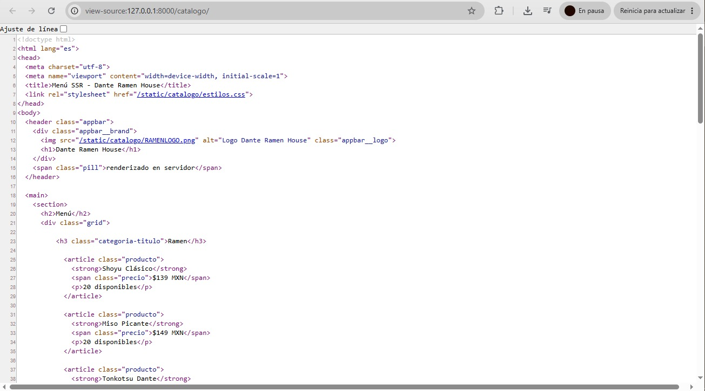
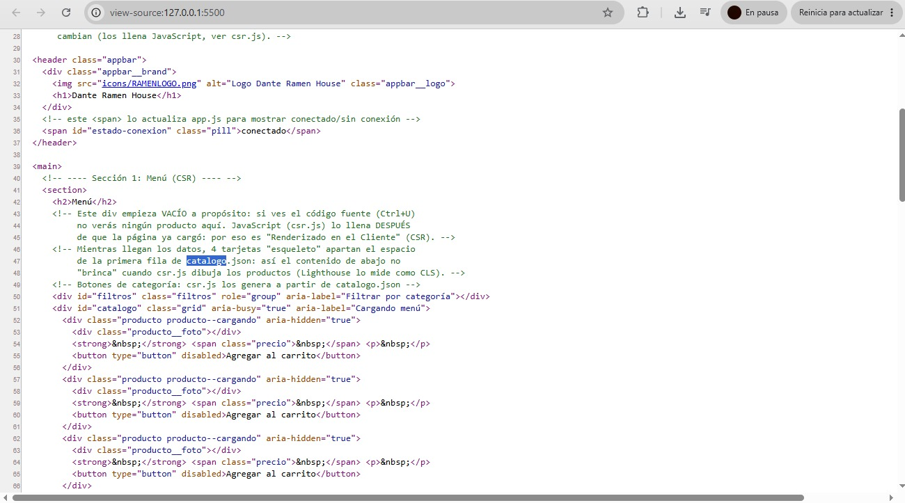

# Nombre de tu negocio — PWA de ventas

| Dato | Valor |
|---|---|
| **Alumno** | URQUIDEZ LOPEZ DANTE YAEL |
| **Grupo** | ING10-1 |
| **Negocio · giro** | DANTE RAMEN HOUSE · casa de ramen japones |
| **URL del repositorio** | https://github.com/UrquidezLopezDanteYael/dante-ramen-house-pwa_urquidez-lopez-dante-yael |
| **URL de GitHub Pages** | https://urquidezlopezdanteyael.github.io/dante-ramen-house-pwa_urquidez-lopez-dante-yael/ |

## Historial de avances

| Avance | Hash del commit entregado | Fecha |
|---|---|---|
| 1 | 69dfaa1 | 11/10/2026 |
| 2 | (hash del avance 2) | 18/10/2026 |
| 3 | (hash del avance 3) | 25/10/2026 |
| 4 | (se escribe en el reporte PDF) | 01/11/2026 |

## SSR vs CSR

**SSR (Django):** los productos ya vienen escritos en el HTML.

**CSR (index.html + csr.js):** el div del catálogo llega vacío y JavaScript lo llena después.

