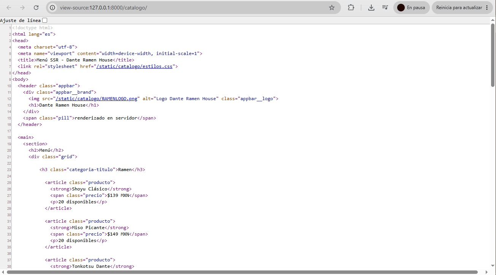
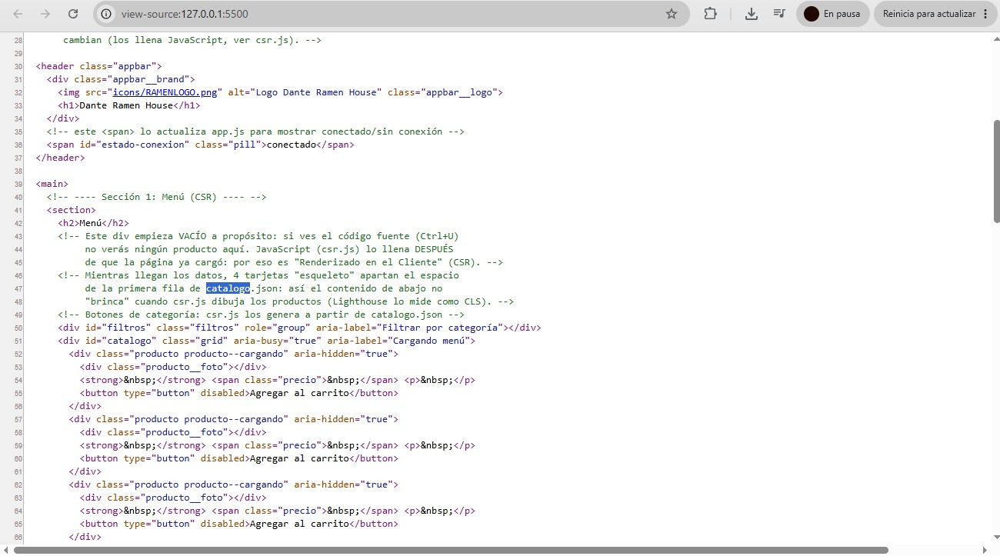
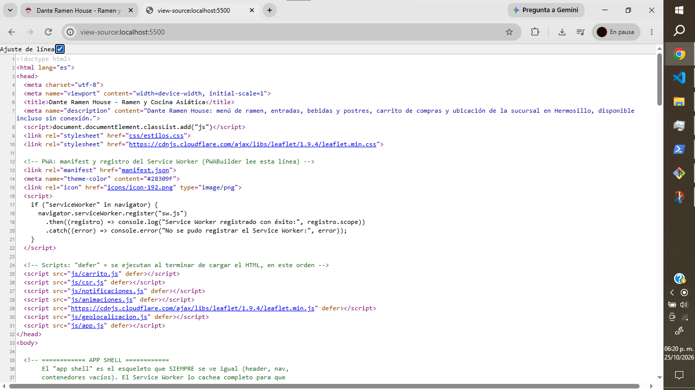
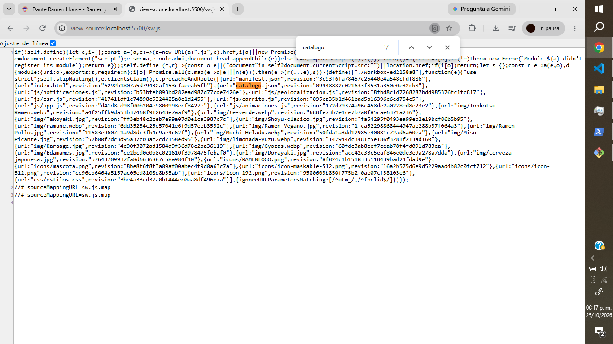
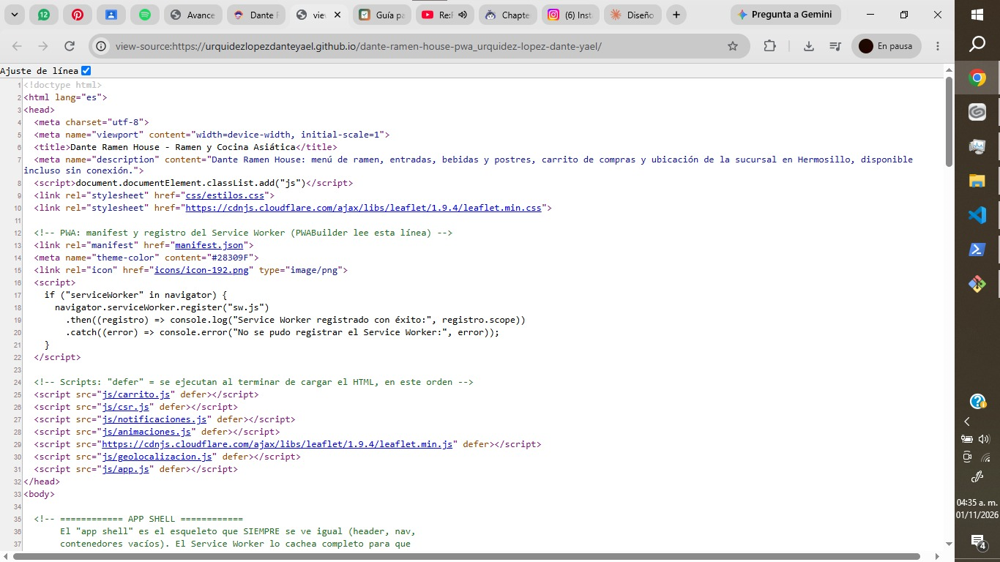
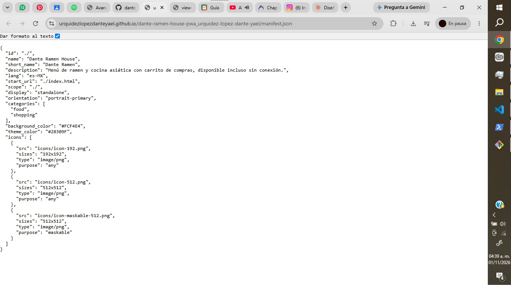

# Nombre de tu negocio — PWA de ventas

| Dato | Valor |
|---|---|
| **Alumno** | URQUIDEZ LOPEZ DANTE YAEL |
| **Grupo** | ING10-1 |
| **Negocio · giro** | DANTE RAMEN HOUSE · casa de ramen japones |
| **URL del repositorio** | https://github.com/UrquidezLopezDanteYael/dante-ramen-house-pwa_urquidez-lopez-dante-yael |
| **URL de GitHub Pages** | https://urquidezlopezdanteyael.github.io/dante-ramen-house-pwa_urquidez-lopez-dante-yael/ |

## Historial de avances

| Avance | Hash del commit entregado | Fecha |
|---|---|---|
| 1 | 69dfaa1 | 11/10/2026 |
| 2 | c03ccc4  | 18/10/2026 |
| 3 | e263f75 | 25/10/2026 |
| 4 | (se escribe en el reporte PDF) | 01/11/2026 |

## SSR vs CSR

**SSR (Django):** los productos ya vienen escritos en el HTML.

**CSR (index.html + csr.js):** el div del catálogo llega vacío y JavaScript lo llena después.

## Funciones PWA (avance 3)

### index.html: manifest y registro del Service Worker activos

### sw.js: Workbox precachea el catálogo y las fotos

## Versión publicada (avance 4)

### index.html en GitHub Pages

### manifest.json en GitHub Pages

### Mi app instalada en el celular

## Guía de instalación y uso
 
### 1. Abrir la app
 
Entra a la dirección de la app desde el navegador:
 
**https://urquidezlopezdanteyael.github.io/dante-ramen-house-pwa_urquidez-lopez-dante-yael/**
 
Navegadores recomendados:
 
| Dispositivo | Navegador |
|---|---|
| Computadora (Windows, Mac, Linux) | Chrome o Edge |
| Android | Chrome |
| iPhone / iPad | Safari |
| Mac | Safari (macOS Sonoma 14 o superior) o Chrome |
 
Firefox puede abrir la página, pero en computadora no permite instalarla como aplicación.
 
### 2. Instalar en la computadora (Chrome o Edge)
 
1. Abre la dirección de la app.
2. Al extremo derecho de la barra de direcciones aparece un ícono de instalar (un monitor con una flecha hacia abajo). Haz clic en él.
3. Pulsa **Instalar** en el recuadro que aparece.
4. La app se abre en su propia ventana y queda un acceso directo en el escritorio y en el menú de inicio.
Si no ves el ícono:
 
- **Chrome:** menú ⋮ → **Transmitir, guardar y compartir** → **Instalar página como aplicación**.
- **Edge:** menú ⋯ → **Aplicaciones** → **Instalar este sitio como una aplicación**.
- **Safari en Mac:** menú **Archivo** → **Añadir al Dock**.
El nombre exacto de la opción puede cambiar un poco según la versión del navegador.
 
### 3. Instalar en Android (Chrome)
 
1. Abre la dirección de la app en **Chrome**.
2. Toca el menú ⋮ (arriba a la derecha).
3. Elige **Instalar app**. En algunas versiones aparece como **Agregar a la pantalla principal**.
4. Confirma con **Instalar**.
5. El ícono de la mascota de Dante Ramen House aparece en tu pantalla principal. Ábrela desde ahí.

### 4. Instalar en iPhone o iPad (Safari)
 
1. Abre la dirección de la app en **Safari**. En iPhone la opción de instalar solo está en Safari.
2. Toca el botón **Compartir** (un cuadrado con una flecha hacia arriba, abajo en la pantalla).
3. Desliza el menú hacia abajo y toca **Agregar a inicio**.
4. Revisa el nombre y toca **Agregar**.
5. Abre la app desde el ícono que quedó en tu pantalla de inicio.
### 5. Usar la app
 
1. **Elige tu platillo.** En la sección **Menú** usa los botones *Todos, Ramen, Entradas, Bebidas* y *Postres* para filtrar.
2. **Agrega al carrito.** Pulsa **Agregar al carrito**: el botón confirma con "✓ Agregado" y el contador del carrito sube. Si ya no hay más unidades de un producto, la app te avisa.
3. **Revisa tu pedido.** En **Tu pedido** usa **+** y **−** para cambiar la cantidad, o **Quitar** para borrar el producto. El total se calcula en pesos mexicanos (MXN). El carrito se guarda en tu dispositivo, así que sigue ahí aunque cierres la app.
4. **Sincroniza el carrito.** El botón **Sincronizar carrito** envía el pedido al servidor. En este proyecto la sincronización es simulada. Si no hay internet, la app te avisa y lo sincroniza cuando regrese la conexión.
5. **Activa las notificaciones.** En **Ofertas**, pulsa **Activar notificaciones** y acepta el permiso del navegador para recibir avisos de promociones.
6. **Cómo llegar.** En **Cómo llegar**, pulsa **Usar mi ubicación**, acepta el permiso y verás la ruta hasta el restaurante en el mapa, con la distancia y el tiempo aproximado.
### 6. Usar sin conexión
 
La app guarda en tu dispositivo el menú, las fotos y los archivos de la página la primera vez que la abres con internet. Después puedes abrirla sin conexión y seguir viendo el menú y armando tu pedido.
 
Sin internet no se puede calcular la ruta del mapa y algunas tipografías pueden verse distintas.
 
### 7. Actualizar y desinstalar
 
- **Actualizar:** la app se actualiza sola cuando la abres con internet. Si no ves los cambios, ciérrala por completo y vuelve a abrirla.
- **Desinstalar en computadora:** abre la app, menú ⋮ en la ventana → **Desinstalar Dante Ramen House**.
- **Desinstalar en Android:** mantén pulsado el ícono → **Desinstalar**.
- **Desinstalar en iPhone:** mantén pulsado el ícono → **Eliminar app**.
